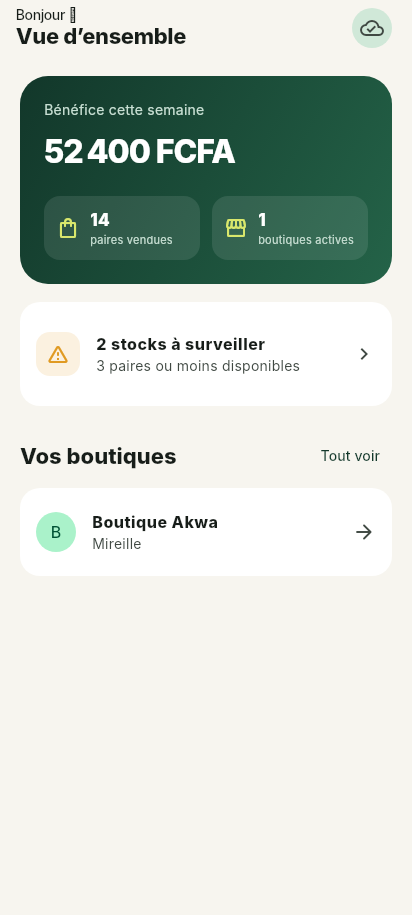
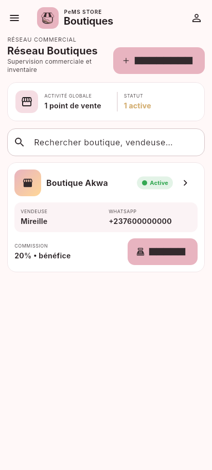

<p align="center">
  
</p>

# PeMS Store

Application Android hors connexion de gestion de stock, ventes et rentabilité pour boutiques de chaussures. PeMS Store suit les variantes et les lots en FIFO, calcule les commissions des vendeuses, produit les bilans hebdomadaires et sauvegarde base et photos dans l'espace privé Google Drive de l'utilisateur.

## Installer

L'APK universel signé est prêt à installer :

- [Télécharger PeMS Store 1.0.6](dist/pems-store-v1.0.6.apk)
- APK optimisés : [arm64-v8a](dist/pems-store-v1.0.6-arm64-v8a.apk), [armeabi-v7a](dist/pems-store-v1.0.6-armeabi-v7a.apk), [x86_64](dist/pems-store-v1.0.6-x86_64.apk)

Sur Android, autoriser ponctuellement l'installation depuis la source utilisée pour ouvrir le fichier. `arm64-v8a` convient à la grande majorité des téléphones récents ; l'APK universel est le choix simple si l'architecture est inconnue.

## Aperçu

| Tableau de bord | Boutiques |
|---|---|
|  |  |

## Fonctionnalités

- boutiques actives/archivées, vendeuse, WhatsApp et rémunération configurable ;
- catégories, articles photographiés, pointures, couleurs et quantités ;
- lots d'approvisionnement, frais de transport et coût de revient calculé en FCFA entiers ;
- vente rapide, contrôle du stock, consommation FIFO et annulation exacte ;
- rapports lundi–dimanche : CA, coûts, bénéfice, stock et catégories ;
- rapport vendeuse distinct sans divulgation des coûts ou marges ;
- PDF multi-page, image PNG de synthèse, partage Android et résumé `wa.me` ciblé ;
- sauvegarde ZIP locale/Google Drive, conservation des 14 dernières et restauration complète ;
- création des identifiants au premier lancement, mot de passe dérivé par
  PBKDF2-HMAC-SHA-256, session de 2 heures, refresh token rotatif et biométrie
  Android ;
- sauvegarde quotidienne WorkManager et rattrapage silencieux au lancement.

## Développement

Prérequis : Flutter 3.47.7 stable ou compatible et Dart 3.13+. Pour Android, Android SDK 36 et JDK 17. Pour Linux, les bibliothèques GTK 3 et les outils CMake, Ninja et Clang.

```bash
flutter pub get
flutter run
```

Lancer l’application desktop Linux :

```bash
flutter run -d linux
```

La base SQLite fonctionne en mode FFI sur Linux. Les sauvegardes y sont locales ; la sauvegarde Google Drive reste disponible sur Android.

Jeu de démonstration, uniquement en debug :

```bash
flutter run --dart-define=PASORA_DEMO=true
```

Le seed crée « Boutique Akwa », un article et un lot de 10 paires à 8 000 FCFA avec 5 000 FCFA de transport.

## Qualité

```bash
dart format --output=none --set-exit-if-changed lib test
flutter analyze
flutter test
```

La suite couvre les coûts, bénéfices, deux bases de commission, semaines entre deux mois, FIFO, dépassement de stock, annulation, migrations SQLite, création/restauration ZIP avec photos, widgets clés et captures golden.

## Construire les APK

Linux/macOS :

```bash
./scripts/build_apk.sh
```

PowerShell :

```powershell
./scripts/build_apk.ps1
```

Les scripts résolvent les dépendances, lancent la génération de code si `build_runner` est présent, vérifient format/analyse/tests, construisent l'APK universel et les APK par ABI, puis les copient dans `dist/`.
Si la vérification de format arrête la construction, lancez `dart format lib test`, puis relancez le script.

## Signature release

Une clé locale RSA 4096 bits a servi aux APK fournis. Elle se trouve dans `android/app/pasora-release.jks` et sa configuration dans `android/key.properties` ; les deux chemins sont exclus de Git. Conserver ces fichiers et leurs mots de passe dans un coffre sécurisé : perdre la clé empêche de publier une mise à jour signée avec la même identité.

Empreinte publique SHA-1 de cette clé :

```text
07:96:78:8C:3E:E7:81:2F:0F:89:8A:48:64:53:06:DA:32:C7:B0:7D
```

Pour créer une nouvelle identité de signature :

```bash
keytool -genkeypair -v \
  -keystore android/app/pasora-release.jks \
  -alias pasora -keyalg RSA -keysize 4096 -validity 10000
cp android/key.properties.example android/key.properties
```

Renseigner ensuite les quatre valeurs dans `android/key.properties`, sans jamais versionner le fichier ni le keystore.

## Google Drive

La partie locale fonctionne immédiatement. Le cloud nécessite l'activation de Drive API et deux clients OAuth Android correspondant au package `com.mamaariege.pasora` et aux SHA-1 debug/release. Suivre [le guide Google Drive](docs/GOOGLE_DRIVE_SETUP.md). Une configuration absente produit un message clair et n'empêche pas la sauvegarde locale.

## Architecture et documentation

- [Architecture, schéma ER et ADR](docs/ARCHITECTURE.md)
- [Décisions et hypothèses](docs/DECISIONS.md)
- [Design system](docs/DESIGN_SYSTEM.md)
- [Branding et logo](docs/BRANDING.md)
- [Configuration Google Drive](docs/GOOGLE_DRIVE_SETUP.md)

Le code suit `presentation → domain ← data`. Le domaine est du Dart pur ; l'interface appelle des cas d'utilisation Riverpod et ne contient ni SQL ni appel Drive.

## Confidentialité

PeMS Store ne possède aucun backend et n'intègre aucune télémétrie. Les données restent dans le sandbox Android. Les sauvegardes locales quotidiennes sont automatiques ; si Google Drive est configuré et autorisé, l'application peut aussi les envoyer dans l'espace privé `drive.appdata` du compte choisi. Une sauvegarde locale reste disponible si l'envoi Drive échoue. La restauration d'une archive PeMS reste une action manuelle. Depuis la version 1.0.5, la restauration automatique des données par Android lors d'une réinstallation est désactivée ; une mise à jour installée par-dessus l'application conserve normalement les données existantes. Les rapports vendeuse omettent volontairement achats et marges.
