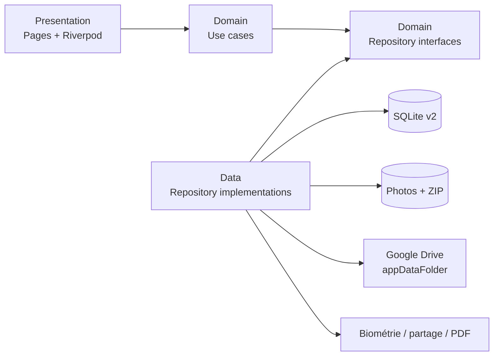
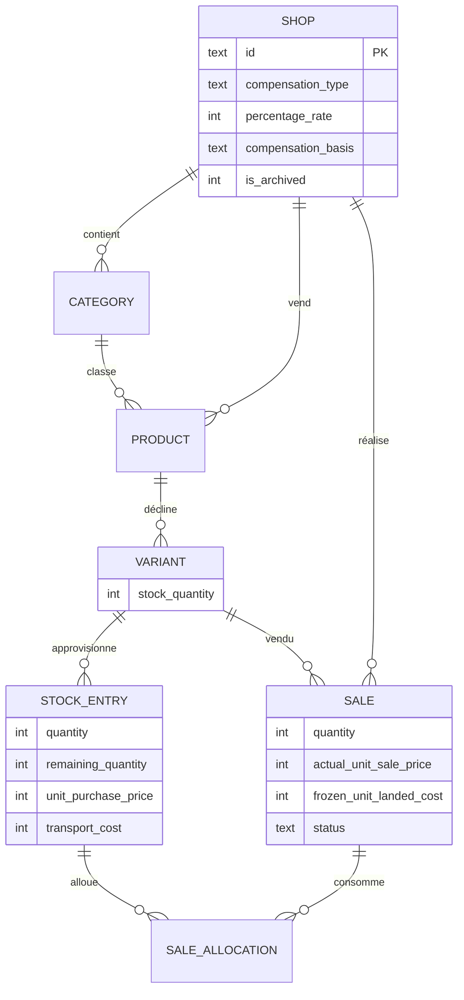
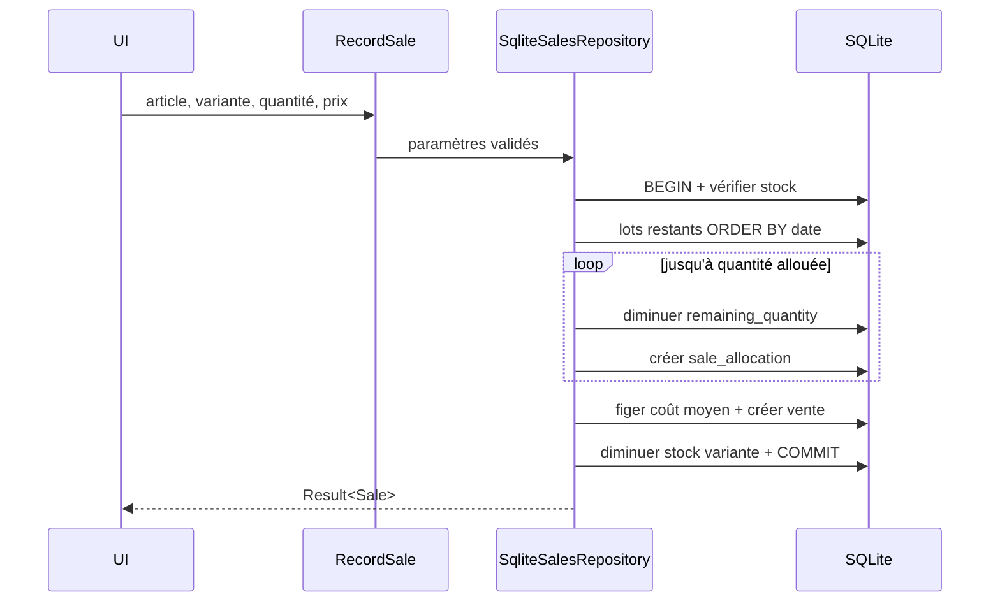

# Architecture de Pasora

## Exigences structurantes

Pasora est une application Android mono-utilisateur, utilisable hors connexion, avec démarrage rapide et données financières exactes en entiers. Elle doit garantir la cohérence entre lots, ventes et stock, produire des rapports hebdomadaires stables et restaurer base et photos sur un autre appareil.

Les risques non fonctionnels dominants sont la perte de données, une vente concurrente dépassant le stock, un changement rétroactif de marge, la fuite des coûts vers la vendeuse et une configuration OAuth absente.

## Vue d'ensemble



La règle de dépendance est `presentation → domain ← data`. Le domaine n'importe ni Flutter, ni SQLite, ni JSON, ni Google. Riverpod assemble les implémentations dans `lib/core/providers.dart`.

## Organisation

```text
lib/
  core/                 # résultat typé, DB, thème, formatage, injection
  features/
    shops/
    catalog/
    inventory/
    sales/
    reports/
    backup/
    settings/
    security/
      domain/           # entités, ports, cas d'utilisation
      data/             # SQLite, fichiers, Drive, appareil
      presentation/     # pages et widgets Riverpod
```

## Modèle de données



Les index couvrent `shop_id`, `product_id`, `variant_id` et `(shop_id, date)`. La vente et l'annulation sont atomiques dans une transaction SQLite.

## Flux critique : vente FIFO



## ADR-001 — Monolithe local Clean Architecture

**Statut :** accepté.

**Décision :** un seul processus Flutter, modules par fonctionnalité et ports de repositories.

**Alternatives :** backend distant rejeté (hors ligne et coût opérationnel) ; découpage en packages Dart rejeté pour la V1 (complexité sans bénéfice pour une équipe petite).

**Conséquences :** déploiement simple et aucune indisponibilité serveur. Le stockage local rend la qualité des sauvegardes critique.

## ADR-002 — SQLite comme source de vérité

**Statut :** accepté.

**Décision :** SQLite/sqflite avec migrations et contraintes étrangères.

**Alternatives :** fichiers JSON (transactions insuffisantes), Drift (plus de génération et temps de build, bénéfice limité pour le schéma présent).

**Conséquences :** transactions robustes et restauration portable ; SQL testé obligatoirement.

## ADR-003 — Coûts figés et allocations de lots

**Statut :** accepté.

**Décision :** conserver sur chaque vente un coût unitaire figé et le détail des lots consommés.

**Conséquences :** rapports historiques stables et annulation exacte, au prix d'une table supplémentaire.

## ADR-004 — Drive `appDataFolder`

**Statut :** accepté.

**Décision :** une archive ZIP autonome dans l'espace privé de l'application, conservation de 14 versions.

**Alternatives :** synchronisation ligne à ligne (conflits et complexité), dossier Drive visible (risque de modification utilisateur).

**Conséquences :** restauration simple ; les fichiers ne sont pas manipulables directement par l'utilisateur dans Drive.

## Modes de panne et réponses

| Panne | Réponse |
|---|---|
| OAuth absent/invalide | résultat d'erreur lisible, sauvegarde locale toujours disponible |
| Réseau absent | fonctionnement métier complet, tentative Drive différée |
| Stock incohérent | transaction annulée intégralement |
| Archive future/corrompue | vérification ZIP + version, aucune substitution |
| Restauration interrompue | copie locale préalable |
| Partage WhatsApp absent | feuille de partage Android vers toute application compatible |

## Sécurité

Base et photos restent dans le sandbox applicatif. Le PIN est salé avec 24 octets aléatoires et haché SHA-256 ; la biométrie délègue au système. Les rapports vendeuse excluent les coûts d'achat et les marges. Les secrets OAuth et de signature ne sont pas versionnés.

